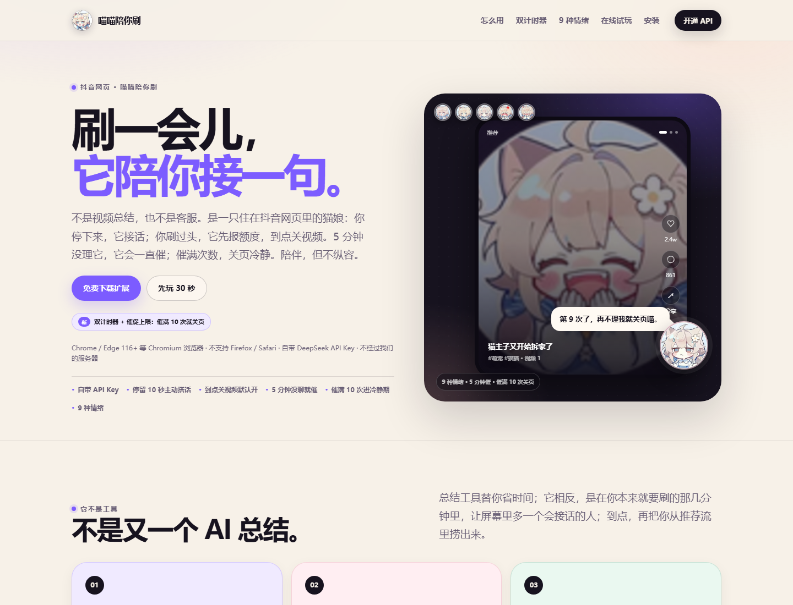
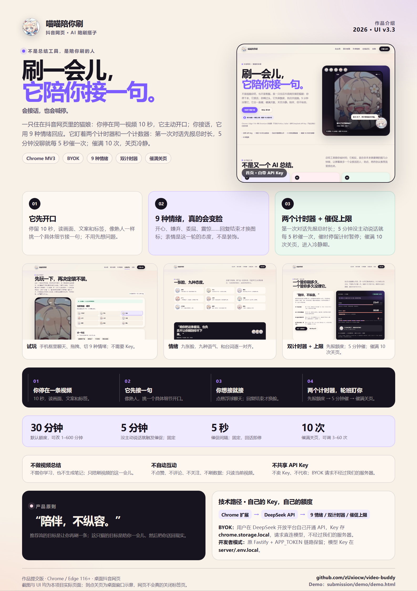
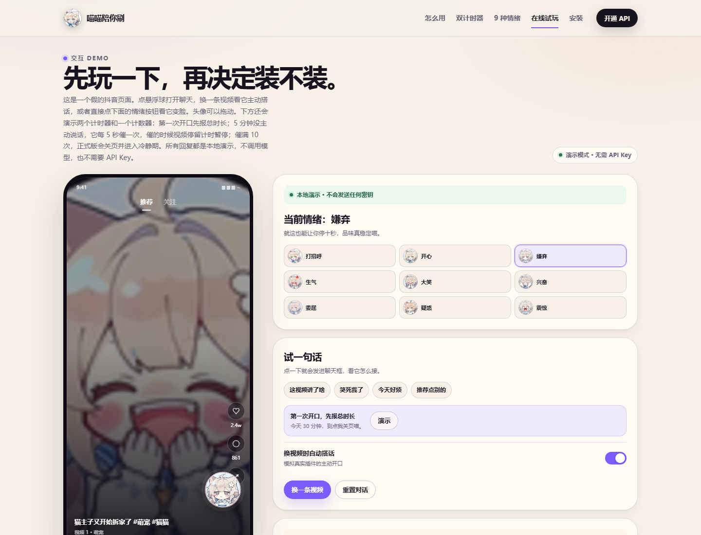
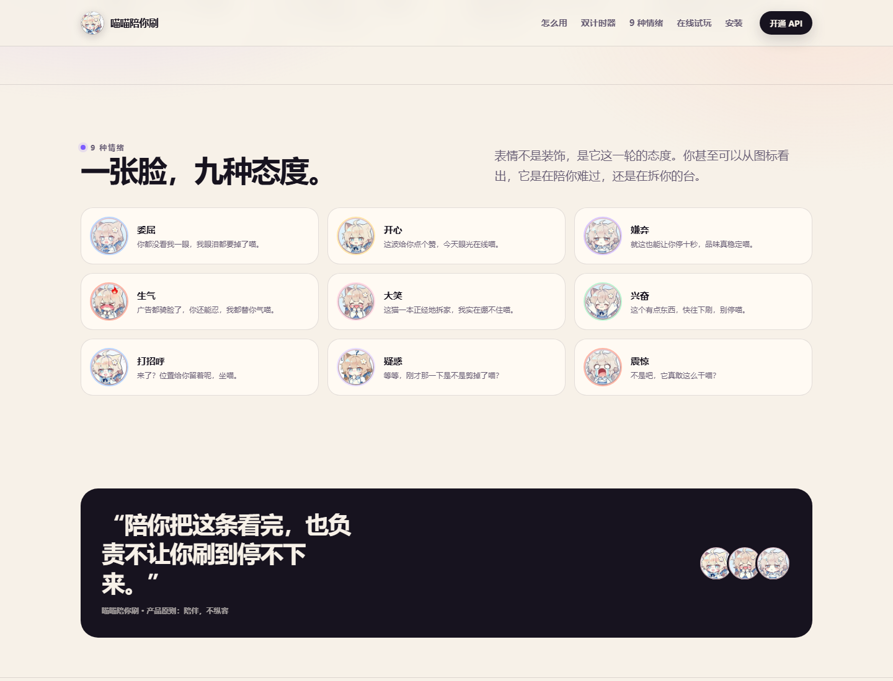
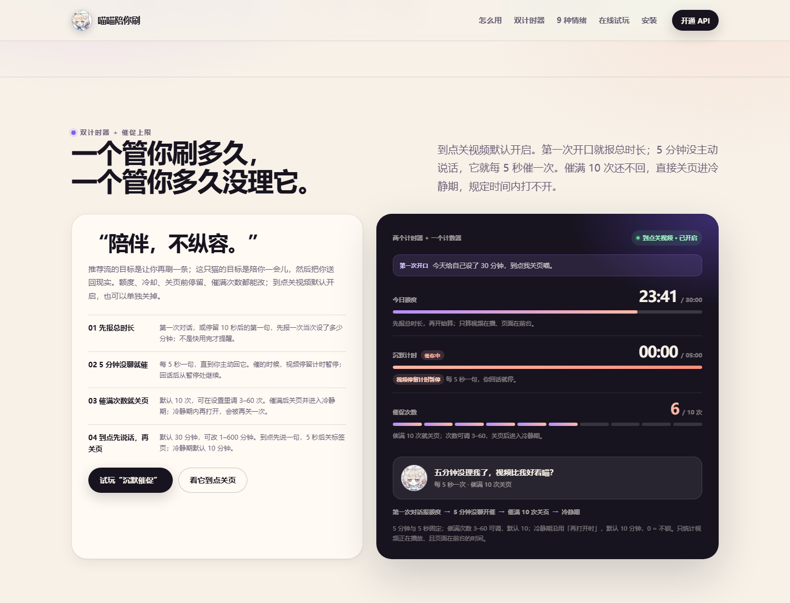
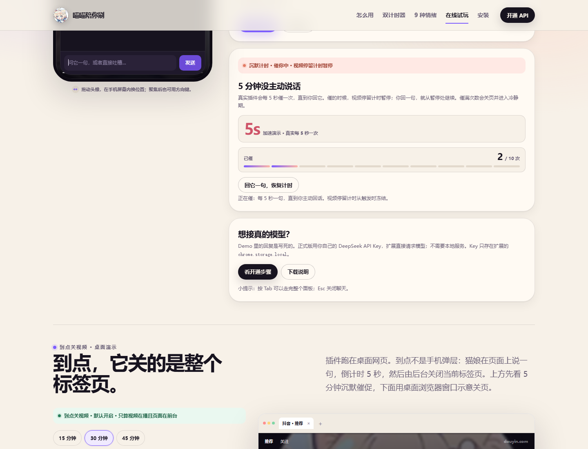
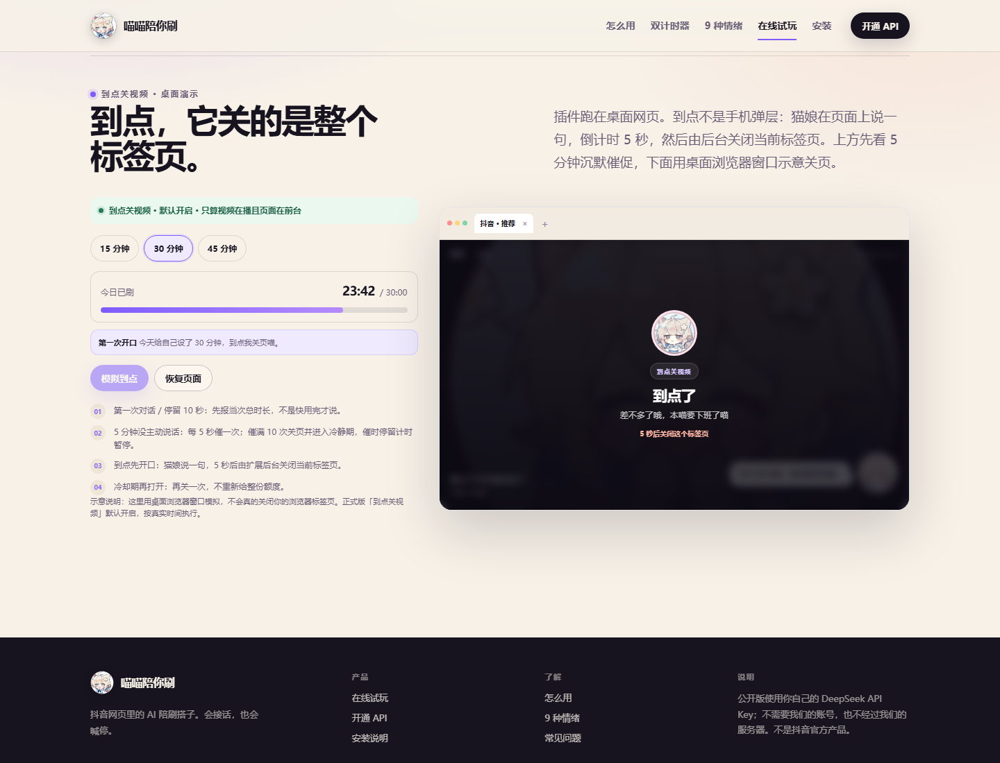
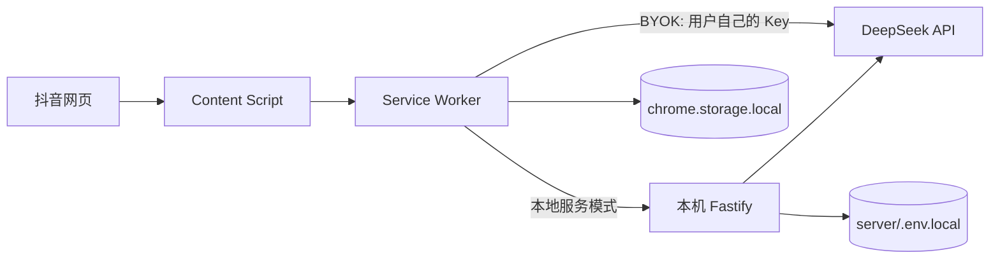

# 喵喵陪你刷

> 住在抖音网页里的 AI 陪刷搭子。  
> **会接话，也会喊停。**



## 这是什么

不是视频总结，也不是客服。

它是一只 Chrome / Edge 扩展里的猫娘：

- 你停在同一条视频上 10 秒，它读画面、文案和标签，主动接一句；
- 你接话，它用 9 种情绪回应，回复结束才换脸；
- 你刷过头，它先报当次总时长；到点先说一句，再关掉标签页；
- 你 5 分钟没主动说话，它会每 5 秒催一次，直到你回它；催的时候视频停留计时暂停；
- 催满次数（默认 10 次，可调 3–60）还不回，它会关掉标签页并进入冷静期，规定时间内打不开；
- 它不点赞、不评论、不关注、不刷数据，也不自动操作你的账号。

产品原则只有一句：**陪伴，不纵容。**

## 作品提交包

| 提交项 | 位置 |
|---|---|
| README | 本文件 |
| 仓库 | [github.com/zUxiocw/video-buddy](https://github.com/zUxiocw/video-buddy) |
| Demo | [`submission/demo/demo.html`](submission/demo/demo.html) |
| 一页作品介绍 | [`submission/one-pager/one-pager.html`](submission/one-pager/one-pager.html) · [PDF](submission/one-pager/one-pager.pdf) · [PNG](submission/one-pager/one-pager.png) |
| 提交索引 | [`submission/README.md`](submission/README.md) |

一页介绍预览：

[](submission/one-pager/one-pager.pdf)

## 功能

| 功能 | 说明 |
|---|---|
| 主动搭话 | 同一视频停留 10 秒后，自动请求一条 reaction；长视频可按间隔复聊 |
| 9 种情绪 | 委屈、开心、嫌弃、生气、大笑、兴奋、打招呼、疑惑、震惊 |
| 聊天 | 点悬浮球打开面板，支持 SSE 流式回复、历史记录和键盘隔离 |
| 双计时器 + 催促上限 | 到点关视频默认开启；第一次对话/停留 10 秒先报总时长；5 分钟没主动说话就每 5 秒催一次，催时停留计时暂停；催满 10 次（可调 3–60）关页进冷静期 |
| 悬浮球 | 可在手机框内拖动、方向键移动、Home 复位 |
| BYOK | 用户自己开通 DeepSeek API，Key 存 `chrome.storage.local`，请求直连模型 |
| 本地服务模式 | 保留 Fastify + `APP_TOKEN` 路径，适合开发者、离线 Mock 或不想把 Key 放浏览器 |

## 截图

| 首页 | 试玩 |
|---|---|
|  |  |

| 9 种情绪 | 双计时器 + 催促上限 |
|---|---|
|  |  |

| 5 分钟没聊就催 | 到点关页 |
|---|---|
|  |  |

> 双计时器与到点关页截图是**桌面浏览器窗口示意**：网页不能真正关闭标签页，真实关闭由扩展后台完成。Demo 里的 5 分钟 / 5 秒和催满 10 次做了加速。

## 快速开始

### 方式 A：BYOK（公开版方向）

1. 在 [DeepSeek 开放平台](https://platform.deepseek.com/) 注册、充值并创建 API Key。
2. 打开 `chrome://extensions`（Edge 是 `edge://extensions`），开启开发者模式，加载 `extension/`。
3. 点扩展图标，在「方式」里选择 **直接用 API Key**，填写 Key 和 API 地址（默认 `https://api.deepseek.com`），测试后保存。
4. 打开抖音网页，刷新页面。

不需要 Node.js，不需要本地服务。API 费用由你和 DeepSeek 结算；插件不卖 Key、不代收、不共享额度。

> “本喵其实也是大胃袋哦，你瘾越重，我能吃的token越多喵”<br>
> 刷得越久、聊得越多、截图越频繁，消耗的 token 越多；费用由你和 DeepSeek 结算，插件不加价。

### 方式 B：本地 Fastify 服务

```powershell
cd server
npm install
Copy-Item .env.local.example .env.local
# 编辑 .env.local：填 DEEPSEEK_API_KEY 和 APP_TOKEN
npm run dev
```

服务默认在 `http://127.0.0.1:8787`。然后在扩展设置里选择「连自己的服务」，填服务地址和 `APP_TOKEN`。

> 本地服务模式下，模型 Key 在 `server/.env.local`；BYOK 模式下，模型 Key 在扩展的 `chrome.storage.local`。两种模式的 Key 不混用。

### 打开网页 UI / Demo

```powershell
cd site
node serve.mjs
```

打开 `http://127.0.0.1:4173`：

- [首页](http://127.0.0.1:4173/index.html)
- [在线试玩](http://127.0.0.1:4173/demo.html)
- [开通 API](http://127.0.0.1:4173/setup.html)
- [安装说明](http://127.0.0.1:4173/install.html)

Demo 不需要 API Key，不调用模型。也可以直接打开 [`submission/demo/demo.html`](submission/demo/demo.html)。

## 架构



- **BYOK**：扩展后台直接请求用户配置的 API 地址，没有我们的中转服务器。
- **本地服务**：扩展 → 本机 Fastify → 模型；模型 Key 留在 `server/.env.local`。
- 网页是独立静态 UI，不持有真实 API Key，也不直接写扩展存储。

## 目录

```text
.
├─ extension/                Chrome MV3 扩展
│  ├─ content/               悬浮球、聊天气泡、限时、拖拽
│  ├─ shared/                设置、情绪、prompt、语音过滤、persona
│  ├─ popup/                 扩展设置
│  ├─ tools/                 打包、e2e、直接模式检查
│  └─ manifest.json
├─ server/                   Node 22 + Fastify + TypeScript
│  ├─ src/routes/            /health、/v1/analyze、/v1/chat
│  ├─ src/providers/         DeepSeek / Mock
│  └─ test/                  Vitest
├─ site/                     公开网页 UI（静态 HTML/CSS/JS）
├─ submission/               作品提交包
│  ├─ demo/                  可独立打开的 Demo
│  ├─ one-pager/             一页作品介绍 HTML/PDF/PNG
│  └─ README.md              提交索引
├─ docs/screenshots/         README 截图
└─ design/                   历史设计冻结版（ui-v1/v2/v3）
```

## 安全与隐私

- 只读当前视频的公开信息、页面文案和可选压缩截图；不读其他标签页。
- 不点赞、不评论、不关注、不刷数据。
- 不自动操作账号，不绕过登录。
- BYOK Key 存在扩展的 `chrome.storage.local`，抖音页面脚本读不到；它不是加密保险箱，能读浏览器配置文件的人仍可能拿到。
- 截图会随请求发给用户配置的模型服务；可在设置里关闭。
- 网页本身不接收、不保存真实 API Key。

## 测试

```powershell
cd server
npm test
```

扩展 / 页面相关：

```powershell
node --check extension/content/buddy.js
node --check extension/shared/core.js
node --check site/app.js
node extension/tools/pack-extension.mjs --out releases
node extension/tools/e2e.mjs
```

`e2e.mjs` 需要本机服务运行；真实抖音页面的限时 / 键盘回归仍建议手动过一遍。

## 状态

- UI v3.3：双计时器 + 催促上限文案与可交互 Demo（首次报额度 / 5 分钟催促 / 催满关页 / 冷静期 / 到点关页），品牌统一为「喵喵陪你刷」。
- 扩展：到点关视频默认开启；催满次数可调 3–60；BYOK 直连模式、权限与打包修复。
- 公开商店安装包尚未发布；当前仓库提供源码与本地打包脚本。
- 不是抖音官方产品。

## 素材与许可

仓库目前未附开源许可证。角色图、9 张情绪图仅用于本项目展示；对外分发或商用前请确认素材授权。第三方依赖遵循各自许可证。
